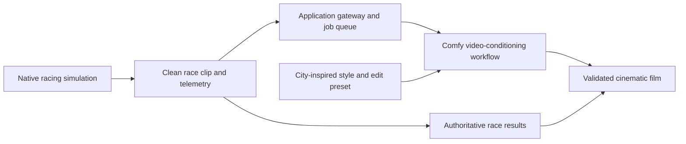

# Comfy Race

**Race the room. Direct your own racing movie.**

An open-source hackathon project combining phone-controlled multiplayer racing with asynchronous cinematic replays made through Comfy workflows.

**Status: documentation-first.** This repository currently contains the project brief, build epic, source audit, and contribution/licensing documents. The game, multiplayer gateway, and Comfy workflows are planned and have not been implemented or benchmarked here.

[Build epic and task tracker](docs/BUILD_PLAN.md) · [Roadmap](docs/ROADMAP.md) · [Source media and citations](docs/SOURCES.md) · [Contributing](CONTRIBUTING.md)

## The experience we want to build

1. **Scan to join.** Open a QR link on your phone, enter a nickname, and choose your driver colour and number.
2. **Race together.** Use your phone as a controller while the projector shows each active driver's view. Start with two human racers, then validate up to five per heat.
3. **Pick your moment.** Select a finish, overtake, or short segment from the actual race recording.
4. **Direct your film.** Choose a city-inspired visual treatment and a supported camera/edit preset.
5. **Create with Comfy.** Submit the clean recording to a tested video-conditioning workflow, then compare the source with the cinematic result and export it.

The race supplies the action. Comfy turns a player's own performance into something they can make and share.

## Inspiration: Matrix-Game 4.0 City Racing

**The media below belongs to the upstream Matrix-Game research project. It is not Comfy Race gameplay or evidence of an implemented feature in this repository.**

[](https://matrix-game-v4-0.github.io/page/assets/gallery/racing_03.mp4)

[Watch the official racing comparison](https://matrix-game-v4-0.github.io/page/assets/gallery/racing_03.mp4) · [Watch the longer racing demonstration](https://matrix-game-v4-0.github.io/page/assets/long/long_racing.mp4) · [Explore the interactive project page](https://matrix-game-v4-0.github.io/page/)

Source and credit: **Skywork AI / Matrix-Game Team**, [Matrix-Game 4.0](https://matrix-game-v4-0.github.io/page/). Images are referenced remotely; upstream media retains its original rights. See [media provenance](docs/SOURCES.md).

## Our approach: the Asynchronous Director



This is the **planned design**, not an implemented deployment. Native gameplay owns physics, checkpoints, collisions, and results. Media generation runs after a selected segment is captured; it cannot block steering or decide who won.

- **Phones are controllers:** touch inputs, HUD, and lightweight telemetry/minimap. No individual video stream is required on each phone.
- **The projector is the shared game display:** every active driver needs a usable view. A composite can reduce encoding/network overhead, while still requiring multiple camera renders.
- **Clean recording comes from the renderer's existing scene layer:** keep names, scores, and HUD outside the model input. Packed clean/HUD frames are a fallback to benchmark.
- **Generation is queued:** one host-selected job at a time initially, with cached fallbacks, explicit credit limits, and recoverable job IDs.
- **A short clip is not a latency claim:** first benchmark 3–5 seconds of source footage, then attempt up to 10 seconds.

Candidate models include MiniMax H3 or LTX workflows. We must verify the exact template/backend supports the required video conditioning; an image-to-video workflow alone does not preserve a complete race trace. [H3 workflow documentation](https://docs.comfy.org/tutorials/video/minimax/minimax-h3), [LTX documentation](https://docs.comfy.org/tutorials/video/ltx/ltx-2-5).

## Creative direction: a world tour

| City-inspired preset | Intended visual direction | Scope |
|---|---|---|
| New York | Dusk, steel and glass, yellow accents | First presentation/replay target |
| Tokyo | Neon, rain and reflected light | Candidate second treatment |
| Nairobi | Warm dusk, contemporary skyline, greenery and original urban graphics | Planned creative preset |
| London | Brick and stone, overcast skies, wet-road atmosphere | Planned creative preset |
| Moscow, Russia | Winter dusk and snow on scenery | Planned creative preset |

These are creative treatments, **not five geographically accurate playable maps**. New roads, collision geometry, traffic paths, or snow traction require engine/level work. A generated film may reinterpret appearance; the real race results remain unchanged.

## What exists and what comes next

| Area | Current state | Next proof |
|---|---|---|
| Brief, epic and source citations | Written | Keep decisions and evidence current |
| Native game foundation | Upstream source reviewed | Pinned build and one local completed race |
| Human multiplayer | Useful upstream simulation/session code identified | Two humans control separate cars in one world |
| Phone controls/projector | Planned | Two controller phones and readable split-screen |
| Five-player heats | Target, not verified | Full heat, reset, disconnect and readability tests |
| Comfy API integration | Planned | One actual app-triggered job with stored output |
| Race Director | Planned | Actual race clip → tested workflow → source/result comparison |
| Comfy Race gameplay video | Not recorded yet | Publish our own recording after the first working build |

The inspected upstream code contains five player slots and race-session logic. Its separate multiplayer server is not wired into the standard build/browser path. Desktop `--players 5` includes AI opponents and is not proof of five-human play. See the [source audit and acceptance gates](docs/BUILD_PLAN.md#3-code-audit-reusable-foundation-and-actual-gaps).

## Get started today

This is currently a documentation checkout; there is no application install or launch command yet.

```bash
git clone https://github.com/thetradingdoc/comfy-race.git
cd comfy-race
```

Read [ROADMAP.md](docs/ROADMAP.md) for the immediate milestones and [BUILD_PLAN.md](docs/BUILD_PLAN.md) for task dependencies, credits, setup prerequisites, tests, and event operations. Runnable setup instructions will be added with the first verified implementation.

Development of the documentation, controllers, contracts, and mocks does not require Comfy credits. Real hosted generation requires the relevant account/API access and compute or credits. Native gameplay does not require downloading Matrix's neural weights. The plan separates those costs and dependencies.

## Hackathon goal and original contribution

Prepared for the [Open Source Higgsfield competition / Comfy Build Night](https://comfy.org/open-source-higgsfield). Our intended contribution is the event game experience and reusable Race Director: shared phone controllers, projector composition, clean capture, source-linked media generation, and a reproducible workflow-driven app.

The competition requires open-source app code, a license, and setup instructions. Partner models are permitted generally; the Open Weights Only category has additional restrictions. Category fit, submission timing, and provider-bonus eligibility still need organizer confirmation. This repository is project preparation, not a submitted or completed entry.

## Attribution and license

Comfy Race builds on research and software by **Skywork AI / the Matrix-Game Team**. We do not claim authorship of their engine, model, or demonstrations. The planned integration starts from [Matrix-Game v4 revision `51913b2`](https://github.com/SkyworkAI/Matrix-Game/tree/51913b2bfa78a6d54de912b8348b1d318f4d36e2/Matrix-Game-4); upstream source is not vendored in this documentation release.

Original Comfy Race contributions are licensed under [Apache-2.0](LICENSE). Upstream software, models, audio, images, videos, and trademarks retain their respective terms. See [NOTICE](NOTICE), [third-party notices](THIRD_PARTY_NOTICES.md), and [source citations](docs/SOURCES.md).
