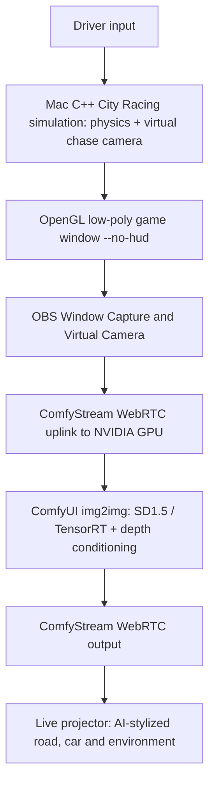

# Comfy Race — live ComfyUI-rendered racing game

**Drive the real game. Watch ComfyUI redraw its world live.**

**Status (November 2, 2026): documentation-first, not yet an implemented or performance-verified game.** V1 uses native C++ racing simulation as a source of low-poly frames, and ComfyStream with a genuine ComfyUI image-to-image workflow to generate the projected AI gameplay visuals. **No replay generation. No Matrix-Game 5B neural renderer in V1.**

[Live system design and build epic](docs/BUILD_PLAN.md) · [Roadmap](docs/ROADMAP.md) · [Setup](docs/GETTING_STARTED.md) · [Source notes](docs/SOURCES.md) · [License](LICENSE)

## Player journey

1. Host starts Matrix-Game City Racing on a Mac, on a supported existing course.
2. One driver uses keyboard first; phone controller after the AI game passes performance tests.
3. OBS captures the **game window**, sends it through OBS Virtual Camera (**not a human webcam**).
4. ComfyStream sends those frames to an NVIDIA GPU; a **real ComfyUI workflow** performs image-to-image stylization on incoming video.
5. Returned WebRTC stream appears on the Mac/projector while the driver is steering.
6. Display source/processed images and measure action-to-photon latency; do not present reference output as AI generation.

## Live architecture

**ComfyUI is the AI visual renderer**, not the physics engine. ComfyStream transports video and runs the graph. Upstream native Matrix-Game's specialized 5B neural renderer is not part of this implementation. The **in-game chase camera is virtual geometry**; OBS Virtual Camera is just a software video device for streaming the game. No player-facing camera.

## Reality check

This integration is planned, not yet playable or benchmarked. G3 requires completing a course looking **only** at the generated view while measuring presented AI FPS, input-to-screen latency, frame drops and visual geometry. Proposed targets (not observed): >=12 presented AI FPS, p95 <=450ms, no repeated >1s freezes. If it fails, we cannot claim a real-time ComfyUI game.

**Scope:** one driver, one supported course, one stable theme. No multiplayer, new world geometry, crowd-controlled weather, or post-race films in V1. See [BUILD_PLAN.md](docs/BUILD_PLAN.md) for 28 tasks and honest stop/go gates.

## Compute

Needs an actual configurable NVIDIA Linux host with CUDA, compatible nodes/models and WebRTC media connectivity. **Comfy credits do not automatically provide such a GPU.** Colab is an experimental fallback only. Original game/asset licenses and model rights remain applicable.

## References

- [Matrix-Game City Racing](https://github.com/SkyworkAI/Matrix-Game/blob/main/Matrix-Game-4/docs/racing.md)
- [ComfyStream](https://github.com/livepeer/comfystream)
- [ComfyStream candidate SD1.5 TensorRT graph](https://github.com/livepeer/comfystream/blob/main/workflows/comfystream/sd15-tensorrt-api.json)

Original Comfy Race contributions are licensed under [Apache-2.0](LICENSE). Attribution and third-party terms: [NOTICE](NOTICE) and [THIRD_PARTY_NOTICES.md](THIRD_PARTY_NOTICES.md).
