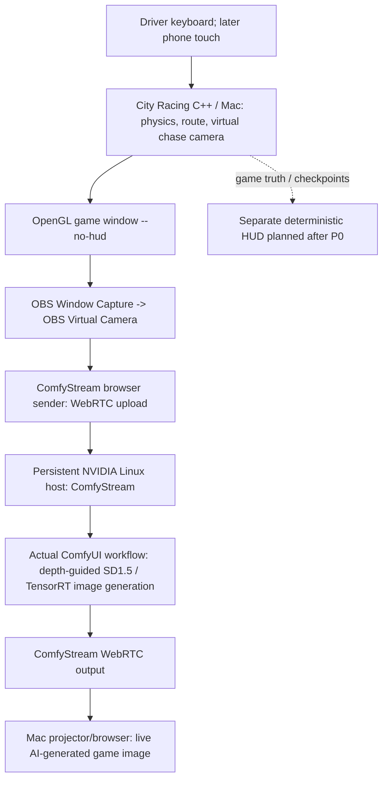

# Comfy Race — LIVE ComfyUI Racing V1: System Design and Build Epic

**Decision: Approach B — ComfyStream executing a real ComfyUI image-to-image workflow during play.**
**Reviewed 2 Nov 2026. Status: source-audited design, not yet built or benchmarked.**

## Product
Drive a real City Racing game **while watching its AI-stylized world live**. ComfyUI generates the visible AI video. Matrix-Game supplies the **C++ simulation and low-poly road/car images only**; its native 5B neural model is **not used**. No replay generation. No user webcam.

## System design

**Camera distinction:** the chase camera is **virtual within the C++ 3D game**; OBS Virtual Camera is merely a software video input for transmitting the game window. Neither is a physical camera pointing at a human.

**Existing ComfyStream entry:** its browser/server support real-time WebRTC video, passing each frame through a ComfyUI workflow with a single primary image input and one image output. Candidate starting graph is [sd15-tensorrt-api.json](https://github.com/livepeer/comfystream/blob/main/workflows/comfystream/sd15-tensorrt-api.json) with depth-conditioning and a one-step LCM sampler. The API-format JSON **does not contain** its weights, TensorRT engines or dependencies; verify on the actual GPU. Output processing frame rate, visual continuity and input-to-screen latency are **unverified** for racing.

**Important:** This is a credible integration plan, not a guarantee of an interactive game. Do not call a raw Matrix-Game native stream “ComfyUI-generated,” or fall back to an offline movie and claim V1.

## What the codebases actually provide

| Source | Existing functionality | V1 change |
|---|---|---|
| [Matrix-Game racing docs](https://github.com/SkyworkAI/Matrix-Game/blob/main/Matrix-Game-4/docs/racing.md) | C++ racing, controls, checkpoint routes | Build and run on Mac; disable HUD for clean conditioning |
| [MainSDL.cpp](https://github.com/SkyworkAI/Matrix-Game/blob/main/Matrix-Game-4/game/racing/src/MainSDL.cpp) | Keyboard/gamepad, virtual camera, game output | No change for keyboard V1; native phone-input hook only P1 |
| [Matrix native stream](https://github.com/SkyworkAI/Matrix-Game/blob/main/Matrix-Game-4/docs/online.md) | Separate causal 5B model inference and WebRTC | Excluded; not a Comfy node |
| [ComfyStream README](https://github.com/livepeer/comfystream) | WebRTC input/output and compatible real ComfyUI graphs | Connect OBS Virtual Camera game source and measure |
| [ComfyStream server/app.py](https://github.com/livepeer/comfystream/blob/main/server/app.py) | aiortc WebRTC receive and processed stream return | Deploy on controllable GPU host |
| [SD1.5 TensorRT graph](https://github.com/livepeer/comfystream/blob/main/workflows/comfystream/sd15-tensorrt-api.json) | One-frame low-step image generation + depth control | Pin engines, models and prompt after testing |
| OBS | Captures game window as virtual video device | Connect output to ComfyStream sender |
| Comfy Cloud | Managed queued workflows | Does **not** automatically provide persistent GPU server or UDP/WebRTC |

## V1 cut and player experience

**P0:** single driver, keyboard, one existing racing route, one fixed tested stylization, Mac game source, actual ComfyUI per-frame stylization on Linux GPU, projector shows returned stream while user drives. No multiplayer, QR code, mid-game city/style switching, AI replay, weather physics or new level geometry.

**P1 only after P0 works:** single phone driver with authenticated WebSocket -> local Mac gateway -> bounded input adapter in C++ game. Reject stale inputs, zero throttle on disconnect and verify mobile gestures. Later optional separate HUD from authoritative telemetry and a second fixed theme between sessions. Do not imply a prompt changes map/collision geometry.

## Deployment and GPU

**Mac source:** follow upstream racing build, obtain legitimate assets, compile CitySampleBBoxGame, run a full course, then run with `--no-hud`. Install OBS, select game-window capture, start virtual camera. In browser select virtual camera as webcam **source device**, not actual human-facing camera.

**Linux inference:** configurable persistent NVIDIA machine, compatible CUDA/PyTorch/ComfyUI/ComfyStream, supported fast SD1.5 TensorRT model+depth nodes, model weights and GPU-specific engines; network path for WebRTC or TURN. Official ComfyStream reported a working Ubuntu RTX 4090 environment; this is NOT a racing benchmark. Prefer abundant VRAM (24 GB is an initial target, not a confirmed requirement) and verify actual selected hardware. Keep models warm.

**Credits/Colab:** event Comfy credits may only buy managed workflows, **not** an SSH-accessible GPU with custom nodes. Confirm event host. Colab is experimental only: GPU type, session lifetime, TensorRT and WebRTC ports/TURN are uncertain. HTTPS tunnel alone does not prove remote WebRTC connectivity.

## Gates — no unmeasured performance claims

| Gate | Acceptance evidence | Failure response |
|---|---|---|
| G0 | Native game builds, race route finished, screen capture | Fix game/assets before AI |
| G1 | Actual ComfyStream ComfyUI workflow changes live video | Fix nodes/models/GPU |
| G2 | OBS game frames reach model and return live | Fix input device/transport |
| G3 | Drive 2 minutes watching ONLY AI output; complete route; measured presented FPS, p50/p95 action-to-photon and stalls | Tune and retest; if it remains unplayable, **do not claim a playable game** |
| G4 | Road/car preserved enough to steer across 3 live runs | Tune conditioning/prompt |
| G5 | Optional phone driving, disconnect stops input | Defer phone if not done |
| G6 | Tested setup, licenses, real demo, pinned workflow | Do not claim reproduction unless validated |

**Provisional G3 targets, not results:** >=12 presented AI FPS, p95 action-to-photon <=450ms, no repeated stalls >1 second. User-perceived control still decides pass/fail.

## Implementation epic (all application items TODO unless verified)

| ID | Pri | Task | Definition of done |
|---|---|---|---|
| E01 | P0 | Pin upstream Matrix + ComfyStream revisions and licenses | Auditable source manifests |
| E02 | P0 | Obtain actual configurable GPU host | SSH, nvidia-smi, disk, GPU model, connectivity |
| E03 | P0 | Build native City Racing on Mac | Full race on supported route |
| E04 | P0 | Deploy sample ComfyStream workflow | Live processed output from real nodes |
| E05 | P0 | Pin SD1.5/TensorRT/depth model stack | No missing model/node, licenses documented |
| E06 | P0 | Capture game window with OBS Virtual Camera | Only OpenGL game appears, no webcam |
| E07 | P0 | Feed virtual camera to ComfyStream browser | Continuous game frames are AI transformed |
| E08 | P0 | Handle game aspect ratio / 512 input | No unacceptable stretched/cropped roads |
| E09 | P0 | Tune one fixed cinematic style | Road/car continuity during driving |
| E10 | P0 | Measure generated FPS, presented FPS and input-to-photon | Raw timing/logs attached; G3 evaluated |
| E11 | P0 | Complete race viewing AI output only | G3 actually passes |
| E12 | P0 | Source/AI diagnostics and explicit loss-of-AI state | Never label reference as AI |
| E13 | P0 | Test venue Mac-projector/network/audio | Actual live end-to-end operation |
| E14 | P0 | Release workflow, instructions, notices and versions | Another builder can reproduce |
| E15 | P0 | Film <=2-min authentic demo | Shows source, ComfyUI graph and real steering |
| E16 | P0 | Validate competition rules and submit | Proper open-source licensing, truthful claims |
| E17 | P1 | One-player mobile touch controls | Steering, accelerator, brake on physical phone |
| E18 | P1 | Authenticated WebSocket controller gateway | Slot/session authentication and bounded commands |
| E19 | P1 | Native latest-input hook for Mac game | No frame-blocking IPC, safe driver control |
| E20 | P1 | Input disconnect and rejoin tests | Input zeroes safely, no controller hijack |
| E21 | P1 | Deterministic HUD from native telemetry | UI text/score not diffusion-generated |
| E22 | P1 | Second fixed style between sessions | Demonstrated without claiming dynamic map change |
| E23 | P1 | QR code single-driver onboarding | One active driver, lifecycle tests |
| E24 | P1 | Media/network recovery | Explicit degraded states, bounded reconnect |
| E25 | P2 | Multi-human racing | Separate engine/encoder/AI capacity project |
| E26 | P2 | Crowd-selected live world morphing | Research, not a shipped feature |
| E27 | P2 | Actual geographical city levels/weather | Native roads/collision/physics needed |
| E28 | P2 | Stateful Matrix 5B native-Comfy integration | Research, not a plug-in |

**Execution order:** E01-E05 -> E06-E10 -> G3 -> E11-E16 -> E17-E24 only if time. No 92-task replay chain or five-camera P0. No auto-generated shots.

## Audit: previous epic's mistakes

| Previous critical-path assumption | Correction |
|---|---|
| Post-race Director job queue and film exporter | Removed: not the product |
| Five simultaneous players / mosaic | Deferred: first prove single AI-view play |
| Matrix native 5B inference described as ComfyUI | Excluded |
| Arbitrary city transformations / prompt weather | Unsupported: only fixed tested visual style |
| Comfy queued cloud credits are streaming GPU capacity | Incorrect; need controllable NVIDIA machine |
| Physical player camera | No; virtual chase camera and OBS software camera |
| Audio/HUD baked into diffusion | No: source without HUD; native HUD later |
| Colab/public tunnel assumed reliable | Experimental, specific GPU/media gates |
| Offline output quality means live play | Incorrect: action-to-photon and stalls decide |
| Source review counted as implemented | None of P0 proven until tested |

**Attribution:** Original source and model/asset licenses remain their owners'. The user-facing V1 must show a genuinely new ComfyStream-to-game integration and the real ComfyUI workflow. Upstream demo videos are NOT evidence of a working Comfy Race application.
