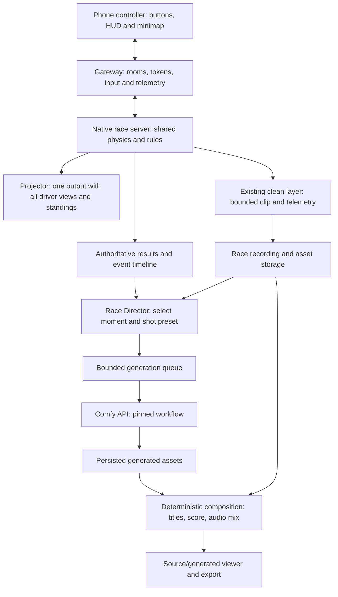

# Comfy Race — end-to-end build epic and task tracker

**Pitch:** Race the room. Direct your own racing movie.

**Prepared:** November 2, 2026. Documentation-first repository edition.  
**Event:** NYC Comfy Build Night, November 2.  
**Status:** Research and implementation plan complete; application implementation has not started.  
**Revision:** 1.1 — controller-only phones, one shared projector output, existing clean-layer reuse, and explicit worker-warmup gate.  
**Target:** Up to five human racers per heat, QR entry, one reliable course, synchronized game audio, live standings, and a Comfy-powered cinematic replay workflow.  
**Minimum demonstration fallback:** Two human racers, the same replay workflow, and an explicitly stated two-player limit. This is a scope reduction, not evidence that five players work.

**Tracker snapshot:** 92 tasks: 5 completed research/repository-preparation tasks, 64 unstarted tasks, 15 tasks waiting for access/venue/decisions, and 8 deferred tasks. No application feature has been marked complete.

**Read first:** sections 1–5 for the decision and feasibility; section 10 for credits; section 11 for the tracker; sections 12–13 for what can start now and the event schedule.

## 1. Decision and competition strategy

Build **City Racing**, with ComfyUI powering a reusable **Race Director** creation product. Players compete, then choose a city-inspired visual treatment, camera preset, and soundtrack mood for a short cinematic interpretation of their actual race.

### Confirmed approach: Asynchronous Director

```text
Native Matrix v4 racing simulation — no neural model in the live game loop
    → selected clean race segment, initially up to 10 seconds + telemetry
    → application gateway, persistent files and bounded job queue
    → tested Comfy video/reference/control workflow + city-inspired prompt
    → validated cinematic interpretation + deterministic result/audio composition
```

The initial experiment may use a shorter 3–5-second clip to measure time, cost and fidelity before accepting 10 seconds. Ten seconds describes source duration, not generation latency. The native racing foundation is official C++ code with our build/gateway/output changes; the standard Python neural server is not a ready multiplayer service we can simply switch on.

Phones are controllers with HUD, low-bandwidth telemetry/minimap and touch feedback. The projector supplies all drivers' usable views. Start with two-driver split-screen, then test a five-view composite and reduce heat size if tiles are unreadable. One encoded composite output does not mean one camera render. Prefer direct host-to-projector display where the implementation permits; remote per-phone video is later scope.

The product should have two valuable outcomes:

1. A room full of people gets an understandable competitive experience.
2. Someone who misses the event can clone the open-source app, run a race or load a supplied recording, and create their own racing film through a documented Comfy workflow.

This is a stronger competition story than an ordinary racer with a generated scorecard. The distinctive contribution is the connection between **real gameplay, meaningful event selection, controllable media generation, and reproducible workflows**. A result card remains a useful low-cost output; it should not be our only Comfy feature.

### How we improve the earlier concept

- Start with a two-human multiplayer proof before building the garage or visual effects.
- Reuse the native racing physics and rules where viable, while treating the browser gateway as new engineering.
- Make Comfy a core creation feature: input footage → selected moment → visual treatment → generated output → comparison/export.
- Preserve the real race result independently of generative video. AI imagery never decides the winner.
- Keep live controls, HUD, sound, and scoring independent of model generation.
- Prepare one polished location treatment and demonstrate a second variant; specify the other cities for later.
- Explain precisely which footage is live, recorded, generated, or cached.
- Measure reliability, latency, cost, and output quality. “Absolute Pipeline Stability” is a design ambition, not a guarantee we can truthfully make.

### Competition fit

The current competition page requires open-source app code, a license, and setup instructions. Partner models are allowed generally; Open Weights Only excludes partner nodes and closed-source APIs. Its categories include Most Innovative and Most Viral. A provider bonus requires that provider's named model to be core to the workflow. The page says the work and its explanation matter more than polished submission-video editing. The published cutoff is November 3 at 9 AM PT / noon ET. [Competition rules](https://comfy.org/open-source-higgsfield)

**Primary positioning:** Most Innovative. **Secondary positioning:** Most Viral through the room tournament and personal racing films. Choose at most one provider bonus after a short workflow benchmark. Winning is uncertain; this plan maximizes clarity, originality, and demonstrable functionality rather than promising a prize.

Luma lists building from **5:30–8:30 PM ET** and demos from **9:00–9:30 PM** at The Yard, 106 W 32nd St. Its older deadline text differs from the competition page; confirm the final cutoff and preparation rules with organizers. [Event](https://luma.com/nyc-yjfm)

## 2. What the supplied examples establish

The two Reddit links are community tutorials, **not verified competing entries**. Their authors' measurements have not been independently reproduced here. The linked workflow files, LoRAs, and dependency graphs have not been executed or audited.

| Example | Author's claim | Practical implication |
|---|---|---|
| H3 long video | Forty seconds assembled from multiple shots, approximately 107 minutes on an RTX 3060 6 GB at 0.6 MP | Useful inspiration for prepared sequences and asynchronous film creation. It is roughly 160 times slower than real time on that reported setup. |
| H3 character swap | Character sheet and LoRA, no manual masking; approximately 20 minutes generation and 21 minutes upscaling | Possible later driver-introduction feature. The post describes 0.4 MP in its overview but 0.5 MP in the timing section; clip duration is not clearly paired with those timings. |

Sources: [long-video tutorial](https://www.reddit.com/r/comfyui/comments/1wo2dsg/comfyui_tutorial_minimax_h3_long_video_40_seconds/), [character-swap tutorial](https://www.reddit.com/r/comfyui/comments/1wzy0w2/comfyui_tutorial_character_swap_with_minimax_h3/).

These examples do not establish responsive steering, physics, multiplayer synchronization, or sound driven by current player inputs. High-quality generated video and audio can enhance the product, but a finished game needs a separate real-time simulation and audio system.

**What we can do better:** give users controllable inputs, show the source, bound the waiting time and cost, offer a usable fallback, and publish an app that reproduces the workflow. We cannot claim better model quality or generation speed without a controlled comparison.

## 3. Code audit: reusable foundation and actual gaps

Audit snapshot: [`SkyworkAI/Matrix-Game` at `51913b2bfa78a6d54de912b8348b1d318f4d36e2`](https://github.com/SkyworkAI/Matrix-Game/tree/51913b2bfa78a6d54de912b8348b1d318f4d36e2/Matrix-Game-4). These are static source findings, not successful local build or runtime results. Pin this revision initially; upgrade only for a specific reason and repeat affected checks.

| Finding | Evidence | Consequence for the epic |
|---|---|---|
| Native world has five player slots | `World.h`: `MaxPlayers=5`, `enableMultiplayer`, `updatePlayers`, per-player cameras | There is useful shared-world racing code to reuse. Five phones are not proven yet. |
| Session has lobby and race rules | `RaceSession.cpp`: join/ready/countdown/input, checkpoints, results, reconnect handling | Adapt its commands through a gateway rather than reimplementing race rules blindly. |
| Separate multiplayer server source exists | `RaceServerMain.cpp`: per-player view rendering, encoded media, IPC | Browser networking and media delivery still need integration. IPC is not a public browser protocol. |
| Separate server is omitted from normal build targets | Racing `CMakeLists.txt` | Add a target and resolve compilation/linking before assuming this path works. |
| Desktop five-player flag is misleading for our purpose | `MainSDL.cpp`: player one manual, other players AI | `--players 5` is not a five-human multiplayer acceptance test. |
| Standard browser neural server remains single-controller | `matrix_game/server/app.py` and online docs | Native multiplayer code and the stock neural browser demo are different paths. |
| Player vehicles use one model | `World.cpp`: multiplayer initialization uses `models[0]`; drawing uses shared `CarColor` | No ready-made human car-selection feature. Distinguishable colours require a renderer change; car geometry selection comes later. |
| Existing rules favor clean racing | `RaceSession.cpp`: contact penalties and recovery penalties | Choose our rules explicitly. NFS-style bumping should not secretly impose clean-racing penalties. |
| Input and disconnect behavior needs phone testing | `RaceSession.cpp`: stale input brakes; disconnect/focus loss pauses the session | A call, tab switch, or dropped phone can stall everyone unless policy is adapted. |
| Multiplayer audio is incomplete at the transport boundary | Race server metadata omits the audio telemetry used by the standard presentation path | Export and schedule per-player/event audio; native audio does not automatically arrive on phones. |
| Clean scene and UI already exist as separate render layers | `RendererGL.cpp` renders scene to layer 0, UI/gates to layer 1, then normal composited readback from layer 2 | Reuse the existing clean buffer/readback machinery for a bounded recording; no new debug capture subsystem. Ordinary stream recording would burn in HUD. |
| Racing tests exist beyond current test targets | `tools/race-tests.cpp` versus CMake's test list | Include the relevant tests explicitly and add gateway/browser integration checks. |
| Castle and Egypt share one shooter implementation | Native games README and `Encounter` | Neither provides an established human-versus-human arena. Defer both for this entry. |
| Flight is shown on the website but not a released supported game here | Project gallery versus released game directories/models | Do not plan air combat as an available implementation. |

Code references: [world interface](https://github.com/SkyworkAI/Matrix-Game/blob/51913b2bfa78a6d54de912b8348b1d318f4d36e2/Matrix-Game-4/game/racing/src/World.h), [session rules](https://github.com/SkyworkAI/Matrix-Game/blob/51913b2bfa78a6d54de912b8348b1d318f4d36e2/Matrix-Game-4/game/racing/src/RaceSession.cpp), [race server](https://github.com/SkyworkAI/Matrix-Game/blob/51913b2bfa78a6d54de912b8348b1d318f4d36e2/Matrix-Game-4/game/racing/src/RaceServerMain.cpp), [build file](https://github.com/SkyworkAI/Matrix-Game/blob/51913b2bfa78a6d54de912b8348b1d318f4d36e2/Matrix-Game-4/game/racing/CMakeLists.txt), [desktop entry](https://github.com/SkyworkAI/Matrix-Game/blob/51913b2bfa78a6d54de912b8348b1d318f4d36e2/Matrix-Game-4/game/racing/src/MainSDL.cpp), [world implementation](https://github.com/SkyworkAI/Matrix-Game/blob/51913b2bfa78a6d54de912b8348b1d318f4d36e2/Matrix-Game-4/game/racing/src/World.cpp), [native games](https://github.com/SkyworkAI/Matrix-Game/blob/51913b2bfa78a6d54de912b8348b1d318f4d36e2/Matrix-Game-4/game/README.md).

Capture evidence: [scene/UI composition before regular readback](https://github.com/SkyworkAI/Matrix-Game/blob/51913b2bfa78a6d54de912b8348b1d318f4d36e2/Matrix-Game-4/game/racing/src/RendererGL.cpp#L713).

### The old ComfyUI bridge

The older `Yuan-ManX/ComfyUI-Matrix-Game` node code runs a video-generation loop over predefined keyboard/mouse conditions. It is not a v4 multiplayer service. Its `LoadMouseIcon` declares four outputs but returns five values. Repairing that mismatch is a separate maintenance task, not the route to our racing app. Keep the old bridge out of the demo dependency chain. [Node source](https://github.com/Yuan-ManX/ComfyUI-Matrix-Game/blob/main/nodes.py)

The demo page's embedded videos did not play in the research browser. We have not visually validated handling, motion quality, audio quality, or responsiveness from those clips. Review them manually or through working playback before making aesthetic claims. [Demo page](https://matrix-game-v4-0.github.io/page/)

## 4. Local readiness and what to configure before arrival

The first implementation needs the following prerequisites. These are project requirements, not claims that a contributor's machine has been configured or a build has passed.

| Area | Requirement | Validation before use |
|---|---|---|
| Native game | Supported macOS/Linux toolchain, CMake, C++20 compiler, SDL2, OpenGL, pkg-config, FFmpeg development libraries | Build and complete a real race; verify required encoder codecs. |
| Gateway/frontend | Supported Node runtime and package manager; Node 22+ for the proposed Comfy SDK | Pin exact versions with implementation. |
| Native assets | Pinned racing assets and verified manifests | Download only needed assets; check size/hash/layout. |
| Generation | Supported Comfy account/API endpoint or self-hosted environment | Verify exact workflow, credential handling, access and approved budget. |
| Optional Matrix neural inference | Supported Linux/NVIDIA host with sufficient disk and graphics runtime | Separate later integration; not required for live native gameplay. |
| Event | Phone control connectivity, shared projector, audio and sightlines | Rehearse on real devices and venue equipment. |

Personal machine inventories and account details belong in ignored local notes, not the public repository.

The pinned manifests list approximately **24.23 GB / 22.56 GiB** of racing-plus-shared model resources before environment/cache overhead. Racing scene assets alone are approximately **56 MB / 53.5 MiB**. A scene-filtered asset manifest selection can additionally include shared shooter assets, totaling roughly **78 MB / 74.6 MiB**. These are manifest sums, not measured download/install sizes. Plan sufficient disk independently of any particular developer machine. [Model manifest](https://github.com/SkyworkAI/Matrix-Game/blob/51913b2bfa78a6d54de912b8348b1d318f4d36e2/Matrix-Game-4/releases/models.json), [asset manifest](https://github.com/SkyworkAI/Matrix-Game/blob/51913b2bfa78a6d54de912b8348b1d318f4d36e2/Matrix-Game-4/releases/game-assets.json)

### Prepare locally now

1. Pin source and create a clean project structure; retain upstream notices.
2. Verify Node version, compiler, SDL2, OpenGL, FFmpeg development libraries, CMake, and pkg-config.
3. Build only the native racing path and download only required game assets.
4. Add the race-server target; run native rules tests.
5. Build the room/gateway interface, phone controls, scoreboard, recording contract, and mocked generation service.
6. Prepare workflow input schemas, city presets, fallback assets, and reproducible setup documentation.

The documented native racing build uses `bash scripts/build_racing.sh -DRACING_ASSET_ROOT="$PWD/resources/racing"` from `Matrix-Game-4/`. The separate multiplayer target still has to be added before this builds our intended server. [Racing setup](https://github.com/SkyworkAI/Matrix-Game/blob/51913b2bfa78a6d54de912b8348b1d318f4d36e2/Matrix-Game-4/docs/racing.md)

### Dependencies that can proceed asynchronously

- Comfy subscription/API access and credits.
- GPU access for video generation or optional Matrix inference.
- Any gated model access or license decision for the chosen workflow.
- Venue network/projector/audio verification.
- Organizers' interpretation of eligibility, preparation rules, and provider bonus requirements.

These do not prevent the local prototype, mocks, schemas, task planning, or source audit. Paid deployment and real generation do depend on the relevant access and an agreed spending cap.

## 5. Product scope and realistic milestones

### Intended end-to-end release

- Up to five human players in a heat, one shared simulation.
- QR guest entry, player colours/numbers, lobby, controller-only phones with HUD/minimap, countdown, results.
- One course with tested checkpoints, collision policy, recovery, and race timeout.
- Tournament queue and final; projector shows every active driver's usable view plus standings in one output. An automated spectator camera is for non-driving moments unless it keeps every driver playable.
- Live audio tied to speed/events, independently of generation.
- Captured source footage and telemetry from an actual race.
- A user-selectable city treatment and camera preset.
- One real Comfy workflow through the app backend, with queued status and persisted output.
- Source/generated comparison, accurate result overlay, download/share.
- Publicly reproducible source, workflows, license/notices, setup and teardown.

### Tonight's scope order

| Gate | Required evidence | If it fails |
|---|---|---|
| G0: Build | Native racer and rules tests work with pinned assets | Timebox dependency repair; decide whether to use a simpler browser racer as an explicit replacement. |
| G1: Human multiplayer | Two people steer two distinct cars in the same simulation; a race finishes correctly | Do not build the garage yet. Resolve gateway/input first. |
| G2: Delivery | Two controller-only phones operate distinct cars while both humans can steer comfortably from their projector tiles | Improve camera/layout, move closer or use a larger display; do not remove a driver's usable view. |
| G3: Scale | Five human controllers plus all five projector views pass a full heat, restart, readability and disconnect tests | Cap demonstrated capacity at two or the tested count; use more heats. |
| G4: Comfy integration | One real supported generation request completes, stores its output, and is viewable | Use a simpler supported image workflow while repairing video; a mock alone is not a finished competition integration. |
| G5: Replay product | Actual captured race input produces a short cinematic output with before/after and provenance | Ship a simpler film sequence using actual footage plus generated intro/background and deterministic editing, labeled accurately. |
| G6: Demo/release | Fresh setup smoke check, license, script, backup recording, and venue rehearsal | Cut remaining features and repair release blockers. |

A replacement browser racer would be a meaningful scope change. It would keep the event game concept, but should not be presented as successful integration of Matrix's native multiplayer code.

### Effort planning

These are rough engineering ranges, not commitments: native build/rules proof 1–3 hours if dependencies cooperate; controller gateway plus two-human projector play 3–10 hours; five-view compositor/readability/audio hardening another 3–10; a first supported Comfy integration 1–4; controlled replay composition 3–8; complete themed UX/release/testing another 6–16. Controller-only phones remove a major media-delivery burden but add a shared-display composition/usability requirement. Some work can run in parallel, but critical dependencies cannot. Full end-to-end scope can exceed one evening substantially.

The hackathon version must be selected by evidence at the gates. Starting with code that looks promising is not equivalent to already having a multiplayer game.

## 6. Architecture



The native simulation remains the sole authority for positions, checkpoint passage, penalties, and the final winner. Browser messages represent player inputs, never trusted finishing times.

### Suggested repository layout

```text
apps/web/                  lobby, mobile controls, scoreboard, Race Director
apps/gateway/              room auth, native IPC adapter, media and asset routes
packages/contracts/        versioned race/job/theme/recording schemas
native/                    pinned upstream reference plus minimal patch set
workflows/                 exported API workflows and manifests
presets/cities/            approved creative presets
presets/shots/             actual camera and edit presets
assets/fallback/           licensed defaults with attribution
tests/                     native integration, gateway, browser, generation failures
docs/                      setup, architecture, demo script, costs, notices
```

Do not commit weights, generated caches, account credentials, or large race recordings to ordinary Git. Include a small licensed test recording and a download/verification mechanism where needed.

### Contracts to define before implementation

| Contract | Required content |
|---|---|
| Room | ID, host credential, player capacity, roster, selected course, state version |
| Player | Opaque session token, name, number, colour, slot, connection and readiness |
| Input | Player binding, monotonic sequence, race ID/epoch, throttle, steer, brake, handbrake; gateway validation |
| Race result | Engine race ID, finishing order, elapsed/penalty/total time, DNF, rules version |
| Recording | Source race, exact timestamps/frame IDs, input and event timeline, clean video, camera metadata, audio/event references |
| Theme | City-inspired label, palette, supported assets, lighting/weather appearance, prompt restrictions, fallback |
| Workflow manifest | Workflow hash, node/dependency versions, model identifier/license, dimensions, duration, seed, supported inputs, output schema |
| Generation job | Saved idempotency/request key, input hashes, workflow version, status, required Comfy job ID, optional downstream provider ID if exposed, attempts, reserved cost, timings, outputs/error |
| Published output | Source race/segment, generated vs original label, persisted asset location, attribution and creation metadata |

Generation states: `queued → submitted → running → validating → ready`; alternatives `failed`, `cancelled`, `unknown`. `Unknown` means recover the recorded Comfy job's status before resubmitting. Partner nodes may not expose a downstream provider ID. Do not imply cancellation stops billing unless verified for that execution backend.

## 7. Multiplayer delivery and game rules

### Browser/media plan

The primary event mode sends **inputs and low-bandwidth telemetry to/from phones, with no per-phone game video**. Each controller shows steering, throttle, brake, readiness, position and a lightweight minimap. Send periodic input/heartbeat updates, clear controls on interruption, and interpolate displayed telemetry without allowing the phone to become the physics authority. Tactile feedback means clear pressed states and optional capability-checked haptics; universal browser vibration support is not assumed.

The server currently has per-player media streams. Change that path so player participation is independent of whether that phone receives video; do not mark controller players invisible merely to skip streaming, because existing focus/readiness logic uses visibility. Keep liveness/focus, camera inclusion and media subscription as separate fields. The gateway owns room/session isolation: native commands trust player identifiers, so bind every command to the guest slot before forwarding it.

For the city/chase-camera course, combine every active player's view into **one projector composite**. Two tiles are the first proof. Test five clearly numbered/coloured tiles at the venue; a camera showing only the top drivers is not usable racing feedback for the others. An alternative single fixed/top-down view is viable only after course/camera design keeps all racers visible.

One composite can use one encoder/output stream, but still incurs multiple camera renders, composition and clean-clip recording cost. Direct local display may avoid network encoding for the projector; a browser-based projector path still needs tested native-to-browser delivery. Five video feeds are a performance risk, not a proven CPU/GPU failure on every host. Measure the actual chosen output and clip recorder together.

Keep readback/video queues bounded and preserve frame/input/race identity. Remote per-phone video and its JPEG/H.264/WebRTC compatibility work are deferred. This is an implementation change, not an existing stock setting.

### Clean recording: smallest patch first

`renderLayers()` already separates clean scene, gates/HUD and composite. First reuse that clean scene layer for a bounded source clip, or select the clean framebuffer with a small mode switch in the existing asynchronous readback path. Avoid a new debug PNG capture subsystem or synchronous per-frame PNG writing. Benchmark recording overhead alongside gameplay.

The proposed **clean-left/HUD-right packed frame** is a fallback if it proves quicker to integrate. It still needs two-panel compositor/viewport logic and encoder dimensions; merely doubling the camera width does not create the layout. At preserved clean resolution it doubles output pixels/readback bandwidth relative to that one view. If used, explicitly encode the panel geometry in metadata, preserve aspect ratio, and crop only the clean panel at the gateway. Do not send the whole projector mosaic as a single-camera conditioning video. For a selected driver's replay, capture or crop its clean tile without names, checkpoint graphics or other HUD baked in. [Existing clean layers](https://github.com/SkyworkAI/Matrix-Game/blob/51913b2bfa78a6d54de912b8348b1d318f4d36e2/Matrix-Game-4/game/racing/src/RendererGL.cpp#L678)

### Recommended first ruleset

- Equal vehicle physics, distinct player identity.
- One short checkpoint course; target 60–90 seconds only after timing real play.
- Three-second synchronized start, host-start control, announced timeout.
- Publish whether ranking uses raw time or time plus penalties.
- Select a friendly arcade-contact policy deliberately. Existing code's contact penalties must be reviewed if bumping is part of the fun.
- Recovery returns to a safe validated location with a visible penalty.
- Finished players spectate. Disconnect grace, rejoin, host removal, and DNF policy must be explicit.
- Preserve pause behavior for testing initially; decide whether event mode should DNF an absent player rather than halt the room.

Vehicle selection starts with colour/number and a driver card. Geometry choices require switching actual meshes and compatible collision/handling configuration. A generated car image alone does not create a playable vehicle or matching physics.

## 8. Cities, weather, and the limits of a prompt

We can make the experience creative with **Nairobi, Tokyo, New York, London, and Moscow, Russia**. We must distinguish three deliverables:

1. **Presentation theme:** garage art, loading scene, palette, optional supported props, ambience, intro and podium. Same underlying course.
2. **Cinematic interpretation:** offline generated treatment of recorded race footage. It can alter appearance and may introduce inconsistencies; review it and label it.
3. **Playable city:** authored road mesh, buildings, collision, traffic paths, checkpoints, navigation and performance tests. This is real level development, not a theme prompt.

The released Matrix renderers are scene-specialized. New geometry, occlusion, fast camera movement, and long sessions can produce drift/errors. Do not assume their racing checkpoint can render all five cities faithfully. [Model limitations](https://huggingface.co/Skywork/Matrix-Game-4.0)

| Preset | Proposed art direction, not a geographic reconstruction | First implementation |
|---|---|---|
| Nairobi | Warm dusk, contemporary skyline, greenery, original urban graphic accents | Garage/podium art and replay treatment; avoid reducing the city to safari imagery. |
| Tokyo | Neon reflections, rain, dense urban atmosphere, original signage | Strong second replay variant; test vehicle and road-edge consistency. |
| New York | Steel/glass, dusk, yellow accents, energetic street presentation | Recommended first event theme because the event is in NYC. |
| London | Brick/stone palette, overcast light, wet-road atmosphere | Prepared theme specification; generate after primary path works. |
| Moscow, Russia | Winter dusk, snow on scenery, broad architectural silhouettes | Presentation/replay experiment; protect road and checkpoint visibility. |

Rain and snow should initially be cosmetic. If slippery handling is offered, define it in the game engine and apply the same announced setting to every player. Generated snow must not imply a collision surface or shortcut that does not exist.

Prepare five theme configuration files; implement one working theme plus one controlled variant tonight. Keep unsupported options visibly unavailable instead of pretending five maps are complete.

## 9. Comfy workflows and multimodal polish

### Workflow A — Event identity and garage pack

Inputs: theme preset, approved palette, player colour/number, style seed. Outputs: event background, driver-card art, optional garage/podium art. Render exact names/numbers with ordinary code after generation. Cache approved outputs. Do not promise a livery is on the actual in-game car until mesh/material support exists.

This is the quickest real integration and a useful fallback, but not the full Race Director product.

### Workflow B — Race Director, the main submission feature

1. Select an actual race and a short segment: finish, close overtake, or clean corner.
2. Use native telemetry and captured frames to establish what happened. If event detection is unfinished, let the host select start/end manually.
3. Choose a real recorded camera preset. New engine viewpoints require recording or reconstructing the engine state; a prompt does not supply an accurate unseen angle.
4. Submit a short supported video-control/stylization workflow through Comfy. Prove the exact node's video/reference support first.
5. Validate output length, visibility, car continuity, and unacceptable road/identity drift.
6. Compose the authoritative result, logo, names, and audio outside the generative frames.
7. Show source/generated comparison and export with workflow provenance.

If the chosen model cannot preserve footage adequately, use generated intro/podium shots plus the original race segment. Describe the result as a racing film assembled from original and generated shots. This remains a usable creation workflow and preserves factual gameplay.

### Workflow C — Audio package

Live game sound: speed/RPM-driven engine loop, braking/skid, impact events, checkpoint, countdown, finish. Use licensed existing samples first, then substitute approved generated assets if useful. Schedule them from simulation/media timestamps. Bind events to race/epoch and player identity, deduplicate impact IDs, and filter contacts for the actual driver; the existing single-player helper's player-zero assumptions must be adapted. Keep collision and finish sounds responsive even when music is muted.

Generated music, ambience, and short announcement clips are prepared assets or post-race jobs. Native generated video audio must not be treated as authoritative synchronized live feedback. Unlock browser audio through a player gesture; offer mute and separate effects/music controls; duck music for announcements and avoid clipping.

### Workflow D — Optional character introduction

A consenting player's fictional avatar or supplied image → character sheet → short driver/podium introduction. This is later scope because identity consistency, licensing, uploaded media handling, and generation time add complexity. No upload is necessary to play; a default avatar always works.

### Model selection

Official H3 documentation describes reference-video and control-video workflows, including edge/depth/pose control. It is a candidate for the Director, subject to exact template/backend verification and any required preprocessing of clean RGB. LTX-2.5 is another video/audio candidate, but its documented T2V/I2V/first-last-frame templates do not alone prove full-video motion conditioning. An I2V job using one frame must not be described as preserving a ten-second race trace. Pick one after testing the exact supported workflow; appearance changes may remain a cinematic interpretation rather than a faithful reconstruction. [H3 guide](https://docs.comfy.org/tutorials/video/minimax/minimax-h3), [LTX guide](https://docs.comfy.org/tutorials/video/ltx/ltx-2-5)

Benchmark a short low-resolution clip first. Keep optional upscale, prompt enhancement, multishot extension, character swap, and elaborate audio generation off the critical path. Review the chosen model's own license and commercial-use terms separately from the app's open-source license.

## 10. Platform setup, credits, and spending controls

Use the current **Comfy API v2 and official SDK** for backend workflow execution. Cloud is the first route if it supports the workflow; use a custom Build/dedicated deployment only when necessary. Router access is not a prerequisite: current documentation has availability caveats. [API v2](https://docs.comfy.org/api-reference/v2/overview), [SDKs](https://docs.comfy.org/development/api-development/sdks)

Documented SDK packages are `@comfyorg/sdk` for TypeScript and `comfy-sdk` for Python. Confirm the installed SDK's version and current examples before implementing calls. Cloud API execution requires a supported paid plan, API key, and available credits; free browser trial runs are not proof of API access. [Cloud setup](https://docs.comfy.org/development/deploy/cloud)

### What requires money or external access?

| Work | Comfy credits? | Other dependency/cost | Can begin now? |
|---|---|---|---|
| Planning, code review, schemas, app code, mocks | No | Existing development tools | Yes |
| Native game build and local play | No | Dependencies, disk, CPU/GPU; existing hardware | Yes, after tool/dependency preparation |
| Phone controllers + shared projector output | No Comfy credits | Host render/encode/recording, low-bandwidth control link, domain/tunnel if used | Yes locally; public access needs gateway configuration |
| Comfy Cloud workflow run | Yes, according to selected service billing | Supported paid API access and credentials | Mock now; real run waits for access/credits |
| Partner-model nodes | Usually chargeable; verify selected node | Account access, provider-specific limits | Configure adapter now; generation waits |
| Local open-weight generation | No Comfy service credits | Suitable hardware or rental, model access/license | Prepare workflow now; actual run waits for compute |
| Dedicated Comfy deployment | Billed compute/storage under selected service | Account, capacity, worker configuration | Prepare definition now; provision after budget decision |
| Matrix live neural rendering | Not inherently a Comfy-credit operation | Linux/NVIDIA host, disk, setup and rental if applicable | Inspect code now; runtime is optional later scope |
| Storage/shareable results | Not necessarily | Hosting/storage/egress | Build local version now |
| Event credits | Unknown | Organizer eligibility, availability and API applicability | Ask; do not make the plan depend on receiving them |

No account changes, package installations, paid jobs, GPU rentals, or deployments were performed for this epic.

### Credit/budget worksheet

Do not invent per-video prices. First get one measured image job and one short video job on the selected workflow. Record queue time, startup, generation, validation, total latency, actual charge, and usable-output rate.

```text
total event cost = selected Cloud workflow charges OR dedicated worker compute
                 + separately billed partner charges, if used by that route
                 + separate Matrix/native hosting, if used
                 + storage + egress

expected generation spend = number of submitted jobs × measured average charge
retry reserve = separately approved maximum additional jobs
```

Keep subscription fees, Comfy credits, dedicated worker charges, and external GPU bills separate in the ledger. Do not count one credit debit again as a second dollar charge. Dedicated workflows that invoke paid partner nodes can incur both worker compute and partner charges. Never assume “open weights” means no compute cost.

Proposed safeguards: host-only generation; one video job at a time initially; a small explicit per-event job allowance; hard maximum duration/resolution; bounded attempts; an application spend cutoff; persistent job IDs; and a clear queue limit. Reserve conservatively before admitting a job and reconcile actual charges afterward. The cutoff prevents new submissions after reserved spend reaches the allowance; it cannot guarantee an exact final bill where charges are unknown or jobs already run. Budget values remain unset until the user chooses a cap. Five players joining must not automatically trigger five costly video jobs.

Repeated `submit()` calls can create separate jobs/charges. Save the idempotency key and Comfy job ID, use the selected backend's supported recovery mechanism, and recover status before resubmitting after a timeout. On `422 idempotency_key_reuse`, retrieve the recorded job. If submission is ambiguous and no ID was saved, flag reconciliation instead of automatically creating a second paid job. Output URLs may require auth or expire; persist assets or refresh authorized URLs rather than placing a protected API URL directly in the public viewer. [SDK behavior](https://docs.comfy.org/development/api-development/sdks), [output contract](https://docs.comfy.org/api-reference/v2/overview)

Dedicated deployments need deliberate worker bounds. Warm workers can continue billing while idle; scaling to zero saves idle compute but adds cold starts. Stopping compute can leave staged storage charges. Prepare a teardown and storage-retention decision, not just a “stop server” button. [Deployment billing](https://docs.comfy.org/development/serverless/overview)

### E14 cold-start protection: operational rule

Do not rely on an open browser tab or one dummy image generation five minutes before the demo. A flex worker can scale down after its idle window (currently documented as about 30 seconds), and an image job need not load the video model or warm the worker serving the actual request.

For a **dedicated deployment**, within the approved budget, temporarily use at least one active minimum worker for the demo window. Start with `min=1, max=1` and an application queue of one generation at a time if this fits the tested workflow. Confirm ready status and run the actual selected workflow on a tiny fixture before the presentation. Keep unrelated jobs away from the demo worker; increasing flex capacity can introduce additional cold workers. Capacity, failures and generation latency can still cause waiting.

For **managed Comfy Cloud**, do not assume control over worker affinity/minimums. Preflight the exact workflow shortly before the demo, enforce the same single-job application queue, and retain the honest cached-output demonstration if the current job is slow. A successful warmup is evidence of readiness, not a latency guarantee. No five-request burst is needed merely because five players finish: one host selects and submits a clip.

Suggested rehearsal: check access/credits/deployment earlier; allow a measured workflow-specific warmup window before the demo; verify the completed test and queue again immediately before presenting. Do not promise a fixed one- or two-minute cold start. Restore economical worker settings or stop compute afterward and account for staged storage. These are planned actions, not paid operations performed here. [Worker behavior and bounds](https://docs.comfy.org/development/serverless/overview)

### Supported configuration sequence

1. Confirm account API access, credits, Node/Python version, and selected workflow availability.
2. Keep API key on the backend; provide `.env.example` with placeholders only.
3. Export and version a minimal working API workflow.
4. Submit one small test, save job ID, inspect outputs, and write the measured ledger entry.
5. Integrate timeout/error/queue behavior before connecting user input.
6. Package a custom Build only if required by unsupported nodes/models.
7. If deploying, inspect current compute options/region, choose worker bounds and budget, then verify billing/teardown behavior.

Candidate Build commands documented by Comfy are `comfy build init`, `comfy build push`, `comfy build release create --target linux/nvidia --watch`, and `comfy deploy refs compute`. These are preparation references, not commands executed here; a definition must match a tested environment. [Build quickstart](https://docs.comfy.org/development/serverless/quickstart)

## 11. End-to-end task tracker

**Status:** DONE = completed research/deliverable; TODO = not implemented; WAIT = named external dependency; DEFER = intentionally outside tonight's default scope. No implementation task is marked done from source inspection alone.

**Priority:** P0 = required for the intended submission; P1 = next improvement after core gates; P2 = later scope. The five-player P0 target may be explicitly reduced if G3 fails.

**When:** NOW = preparable before arrival, EVENT = requires venue/organizer access, AFTER = later expansion. NOW tasks with unfinished dependencies are not immediately executable.

**Cost:** F = no Comfy credits for development/local execution; C = real Comfy/API generation or service charges; H = hosting/compute/storage may cost money; A = account, model-access, budget, or organizer decision. F does not mean developer time or existing hardware is free.

**Owners:** Implementation = contributor implementation/research; Maintainer = account/budget/product decisions; Organizers = answers or venue facilities. Owners are proposed roles, not commitments from particular people.

### A. Evidence, rules, and setup

| ID | P | Status / when | Owner | Depends on | Cost | Task and acceptance condition |
|---|---|---|---|---|---|---|
| A01 | P0 | DONE | Implementation | — | F | Audit pinned v4 source; distinguish native multiplayer code from single-user neural demo. Findings recorded in section 3. |
| A02 | P0 | DONE | Implementation | — | F | Review Reddit claims and competition/event pages; record provenance and uncertainty. |
| A03 | P0 | DONE | Implementation | — | F | Read-only local preflight and manifest footprint; identify missing PATH tools and model disk shortfall. |
| A04 | P0 | DONE | Implementation | A01–A03 | F | Deliver this epic, scope gates, credit map, and task tracker. |
| A05 | P0 | DONE | Implementation | A01 | F | Initialize documentation-first repository with README, license, notices, task plan and pinned upstream source reference. Native checkout/build remains A09–A12. |
| A06 | P0 | TODO / NOW | Implementation + Maintainer | A05 | F/A | Inventory app/code/model/assets/audio licenses; choose app license, retain notices, document actual upstream reuse and original changes. Resolve any unknown asset rights before redistribution. |
| A07 | P0 | WAIT / NOW or EVENT | Maintainer + Organizers | — | A | Confirm eligibility, pre-event preparation, reused upstream code, team/submission rules, and final cutoff. Record answers; no need to delay independent local preparation. |
| A08 | P0 | WAIT / NOW | Maintainer | — | A | Select spending cap and available Comfy/GPU accounts; record what may incur charges. No paid work begins with an unset allowance. |
| A09 | P0 | TODO / NOW | Implementation | A05 | F | Verify Node 22+ for chosen SDK, compiler/SDK, disk, encoder codecs; record exact versions without collecting secrets. |
| A10 | P0 | TODO / NOW | Implementation | A09 | F | Prepare/install required native dependencies; SDL2/FFmpeg headers and `libx264` or `mjpeg` encoding work, not just FFmpeg CLI presence. |
| A11 | P0 | TODO / NOW | Implementation | A05,A06 | F | Download only pinned racing assets; verify sizes/hashes and document required layout. No neural weights locally. |
| A12 | P0 | TODO / NOW | Implementation | A10,A11 | F | Compile native racer and complete one course/reset; retain logs and actual control/visual observations. Pass G0. |

### B. Native game and human multiplayer proof

| ID | P | Status / when | Owner | Depends on | Cost | Task and acceptance condition |
|---|---|---|---|---|---|---|
| B01 | P0 | TODO / NOW | Implementation | A12 | F | Add CMake target for race server and encoder dependencies; executable emits valid IPC hello and shuts down cleanly. |
| B02 | P0 | TODO / NOW | Implementation | A12 | F | Wire existing race rule/shared-world tests into build; checkpoint, contact, recovery, reconnect invariants pass. |
| B03 | P0 | TODO / NOW | Implementation + Maintainer | B02 | F | Choose/version scoring and contact rules; visible rules match engine ranking, ties, DNF and recovery behavior. |
| B04 | P0 | TODO / NOW | Implementation | B01 | F | Build native IPC supervisor/adapter; framed data parsed with size limits, correlated requests and bounded shutdown/restart. |
| B05 | P0 | TODO / NOW | Implementation | B04 | F | Bind two independent input sources to separate cars; simultaneous movement and physical interaction verified in one world. |
| B06 | P0 | TODO / NOW | Implementation | B03,B05 | F | Complete two-human race including countdown/results/restart; engine result agrees with observed checkpoints and published scoring. Pass G1 once browser devices are connected. |
| B07 | P0 | TODO / NOW | Implementation | B04 | F | Set input bounds/rate/sequence/epoch handling and release-on-loss; stale input brakes and old-race inputs cannot move a new car. |
| B08 | P0 | TODO / NOW | Implementation | B03,B06 | F | Implement timeout, disconnect grace/DNF and host recovery policy; one absent phone cannot block all heats indefinitely. |
| B09 | P0 | TODO / NOW | Implementation | B06 | F | Add per-slot colours/numbers and persisted identity; every racer is distinguishable with identical tested physics. |
| B10 | P0 | TODO / NOW | Implementation | B06,B08 | F | Full-room and late-join policy; sixth active player rejected/queued, no join during active race, host can end/reset safely. |
| B11 | P1 | TODO / NOW | Implementation | B09 | F | Garage identity preview matches actual in-game colour/number; no imaginary model choice displayed. |
| B12 | P2 | DEFER / AFTER | Implementation | B11 | F/H | Real car model/class selection, collision and handling balance; each option has actual compatible geometry and tested fairness. |

### C. Gateway, browser, mobile and spectator experience

| ID | P | Status / when | Owner | Depends on | Cost | Task and acceptance condition |
|---|---|---|---|---|---|---|
| C01 | P0 | TODO / NOW | Implementation | A05 | F | Version shared contracts and build engine mock; browser/gateway can develop before native build finishes. |
| C02 | P0 | TODO / NOW | Implementation | C01 | F | Room lifecycle, nickname entry and opaque guest/host tokens; player cannot control another slot or call host actions. |
| C03 | P0 | TODO / NOW | Implementation | C02,B04,B07 | F | Connect browser input/state to native adapter; reconnect restores intended identity without a duplicate controller. |
| C04 | P0 | TODO / NOW | Implementation | B04 | F | Add one local projector composite/output with two then five camera tiles; disable phone video subscriptions without breaking player focus/readiness. Frame queues bounded; encoder count measured. |
| C05 | P0 | TODO / NOW | Implementation | C03,C04,B06 | F | Two controller-only phones control distinct cars while both drivers use their numbered projector tiles; race finishes/restarts without view/identity swaps. Complete G1. |
| C06 | P0 | TODO / NOW | Implementation | C01 | F | Touch steering/pedals, keyboard fallback, landscape layout and multi-touch release; dragging off buttons or rotation cannot leave throttle stuck. |
| C07 | P0 | TODO / NOW | Implementation | C05,C06 | F/H | Test iOS Safari/Android Chrome controls, HUD/minimap and optional haptics with actual projector sightlines; no phone video required. Log responsiveness and support limits. Pass G2. |
| C08 | P0 | TODO / NOW | Implementation | C05,B09 | F | Lobby/ready/countdown/HUD/finish screen; names, positions and penalties remain legible and come from native state. |
| C09 | P0 | TODO / NOW | Implementation | C02,C04,C08 | F | Projector shows every active driver's view with legible identities, standings and QR; no leaders-only camera during driving. Local display/one-composite stream selected and measured. |
| C10 | P0 | TODO / NOW | Implementation | C07,C09 | F/H | Five phone controllers + all projector views + clean recorder benchmark; measure readability, camera-render/composition/encode load and input-to-projector latency. Pass G3 only at usable full-demo capacity. |
| C11 | P0 | TODO / NOW | Implementation | C08,B10 | F | Heat queue and deterministic advancement rules; a complete sample tournament produces the right final roster. |
| C12 | P2 | TODO / AFTER | Implementation | C04,C07,C10 | F/H | Optional remote per-phone video: separately integrate/test JPEG/H.264/WebRTC and device compatibility after shared-projector mode works. Not required tonight. |
| C13 | P1 | TODO / NOW | Implementation | C09,C11 | F | Audience voting for next theme/final wildcard with one-vote policy; voting never changes active race physics secretly. |

### D. Audio, recording and deterministic replay source

| ID | P | Status / when | Owner | Depends on | Cost | Task and acceptance condition |
|---|---|---|---|---|---|---|
| D01 | P0 | TODO / NOW | Implementation | B04,A06 | F | Export per-player speed/RPM/slip and unique impact/checkpoint events with race/epoch and timestamps; filter contacts to the correct driver, avoiding player-zero assumptions. |
| D02 | P0 | TODO / NOW | Implementation | C05,D01 | F | Adapt licensed audio to shared projector mix; gesture unlock, selected-view engine sound or bounded mix, event deduplication and race/epoch reset. Phone cues optional; compare with visible host events. |
| D03 | P0 | TODO / NOW | Implementation | D02 | F | Effects/music mute, volume, pause/reconnect reset, ducking and clipping checks; no duplicated impacts or engine after leaving. |
| D04 | P0 | TODO / NOW | Implementation | B04,C04 | F/H | Reuse existing clean scene layer/readback for a bounded selected-camera clip plus telemetry; no new debug capture subsystem. Packed clean-left/HUD-right layout is a measured fallback, not a free width toggle. |
| D05 | P0 | TODO / NOW | Implementation | D04 | F | Export selected clean clip, initially 3–5 seconds then up to 10; if packed, crop documented clean rectangle with correct aspect. Verify no HUD/mosaic, exact timing and separate audio/UI. |
| D06 | P0 | TODO / NOW | Implementation | D05 | F | Implement manual start/end moment selection and finish preset; selected footage is traceable to the race. |
| D07 | P1 | TODO / NOW | Implementation | D04,D06 | F | Automatically identify finish/overtake/near miss from actual telemetry; validate event rather than infer it from generated pixels. |
| D08 | P1 | TODO / NOW | Implementation | D05 | F/H | Record actual additional camera footage, or prove deterministic replay from complete initial state/all simulation inputs. Input traces/camera metadata alone do not establish reconstructability. |
| D09 | P1 | WAIT / NOW | Implementation + Maintainer | E06,A08 | C/H | Generate and approve original ambience/music package; loops mix cleanly and model/license attribution is recorded. |

### E. Comfy generation service and reusable workflows

| ID | P | Status / when | Owner | Depends on | Cost | Task and acceptance condition |
|---|---|---|---|---|---|---|
| E01 | P0 | TODO / NOW | Implementation | C01 | F | Build typed job adapter/mock with success, slow, failure and unknown-status scenarios; race remains playable in every case. |
| E02 | P0 | TODO / NOW | Implementation | E01 | F | Durable idempotency keys, Comfy job IDs and cache hashes; optional downstream IDs distinct; same request recovers job/output rather than blindly submitting. |
| E03 | P0 | TODO / NOW | Implementation | E01,A08 | F | Implement host-only generation, queue/duration/resolution/attempt caps and spend ledger; unauthorized guest or cap breach cannot start paid work. |
| E04 | P0 | WAIT / NOW | Maintainer + Implementation | A08 | A | Verify API entitlement/key and credits or self-host endpoint; secrets remain server-side and are absent from repo/client logs. |
| E05 | P0 | TODO / NOW | Implementation | E01 | F | Define Workflow A/B manifests and small input fixtures; schemas reject unsupported cities, malformed media and oversized jobs. |
| E06 | P0 | WAIT / NOW | Implementation | E02–E05 | C/H | Run one minimal real image workflow, persist output and measure latency/charge; UI displays real result. Pass G4. |
| E07 | P0 | WAIT / NOW | Implementation | E06,D05 | C/H/A | Benchmark exact full-video/reference/control template and needed RGB-to-control preprocessing; a one-frame I2V job is not full-trace conditioning. Verify outputs/license/cost/latency, then select core model. |
| E08 | P0 | WAIT / NOW | Implementation | E07 | C/H | Export/pin real runnable API workflow, node/model versions and seed/config; a second known fixture produces acceptable output. |
| E09 | P0 | TODO / NOW | Implementation | E02 | F/H | Asset persistence and authorized retrieval; output remains usable after provider URL expiry and does not expose API credentials. |
| E10 | P0 | TODO / NOW | Implementation | E03,E08,E09 | F/C | Test queue-full/no-credits/auth/timeout/network/provider errors, saved-key replay and idempotency-key reuse. Ambiguous submission without job ID requires reconciliation; no automatic second charge. Race survives. |
| E11 | P0 | WAIT / NOW | Implementation | D06,E08–E10 | C/H | Race Director request uses actual recorded segment and supported preset; generated output survives validation and has provenance. |
| E12 | P0 | TODO / NOW | Implementation | E11,D03 | F/H | Deterministic final composition with real ranking, exact names and mix; source/generated labels and export work. Pass G5. |
| E13 | P1 | TODO / NOW | Implementation | E12 | F/H | Short-lived sharing or export page with access/retention policy; another device can open output without Comfy credentials. |
| E14 | P0 | WAIT / NOW | Implementation | E08,A08 | C/H/A | Demo readiness: dedicated min=1/max=1 within budget plus actual-workflow warmup, or Cloud preflight with no affinity assumption. Single-job queue; ready/status checked; idle browser/dummy image is insufficient. Restore settings afterward. |
| E15 | P2 | DEFER / AFTER | Implementation + Maintainer | E12 | C/H/A | Optional avatar/character-swap introduction; consent, identity QA and fallback validated before release. |
| E16 | P2 | DEFER / AFTER | Implementation | E12 | C/H | Multishot, upscale and generated announcer packages; each adds measured value within an approved budget. |

### F. Themes and environment creativity

| ID | P | Status / when | Owner | Depends on | Cost | Task and acceptance condition |
|---|---|---|---|---|---|---|
| F01 | P0 | TODO / NOW | Implementation | E05 | F | Write five city-inspired preset specs and approved/fallback asset manifest; no claim of geographic reconstruction. |
| F02 | P0 | WAIT / NOW | Implementation | F01,E06 | C/H | Produce and approve first NYC presentation pack; logos/text deterministic, player identity legible, licenses tracked. |
| F03 | P0 | TODO / NOW | Implementation | F02,C08 | F | Apply pack before heat and lock theme/handling for everyone; missing assets fall back without delaying countdown. |
| F04 | P1 | WAIT / NOW | Implementation | E11,F02 | C/H | Generate second Tokyo or Nairobi film treatment from controlled source; demonstrate actual before/after differences. |
| F05 | P1 | TODO / NOW | Implementation | F01,F03 | F | Preview/select theme UX; unimplemented cities unavailable or labeled planned; no silent swapping of the actual map. |
| F06 | P2 | DEFER / AFTER | Implementation | F04 | C/H | Approve remaining Nairobi/London/Moscow packs with road-edge/car-continuity QA and appropriate art direction. |
| F07 | P2 | DEFER / AFTER | Implementation | B03,F03 | F | Optional wet/snow handling preset; actual engine grip changes tested and equal across players. |
| F08 | P2 | DEFER / AFTER | Implementation | A06,B02 | H/A | Genuine new city level pipeline: licensed geometry, collision, route/navigation, traffic, lighting and performance; five themes are not five maps. |

### G. Reliability, deployment and event operations

| ID | P | Status / when | Owner | Depends on | Cost | Task and acceptance condition |
|---|---|---|---|---|---|---|
| G01 | P0 | TODO / NOW | Implementation | C05,E01 | F | Integration harness drives known race and generation failures; useful rule/protocol invariants pass, not tests that merely echo code. |
| G02 | P0 | TODO / NOW | Implementation | C07,D03 | F | Device interruption matrix: background/rotation/off-button release/drop/rejoin/audio gesture; no stuck input or stolen slot. |
| G03 | P0 | TODO / NOW | Implementation | C10,B08 | F/H | Ten complete start/finish/reset cycles at demonstrated capacity; bounded memory/encoder queues, no stale media or ghost players. |
| G04 | P0 | TODO / NOW | Implementation | E10,E12 | F/C | Credits exhausted, slow/failing job and network outage do not block active race; previous approved output and local fallback remain available. |
| G05 | P0 | TODO / NOW | Implementation | E12,F03 | F | Visual/audio QA: correct names/results, readable HUD, audio sync/mix, no unacceptable car count/identity/road drift in approved generated clip. |
| G06 | P0 | TODO / NOW | Implementation | C02,E03 | F | Guest/host isolation, input limits, upload limits, safe media paths and no secrets in client/logs; cost endpoints require host authority. |
| G07 | P0 | WAIT / NOW | Implementation + Maintainer | C07,G06,A08 | H/A | Select hosting/local-plus-tunnel and HTTPS route; only intended gateway exposed, never native IPC or raw Comfy admin access. |
| G08 | P0 | WAIT / EVENT | Maintainer + Implementation | G07 | H/A | Confirm phone control connectivity, host/projector link, brightness/resolution/sightlines and audio; all drivers can read tiles. QR resolves from real phones; independent camera stream to each phone unnecessary. |
| G09 | P0 | TODO / NOW | Implementation | G07,E14 | H | Host health/restart controls, timestamps and bounded logs; generation and game process fail independently with clear status. |
| G10 | P0 | TODO / NOW | Implementation | D04,E09 | F/H | Retention/storage limits and deletion policy; save only needed race/media data and protect shared output access. |
| G11 | P0 | TODO / NOW | Implementation | G09,A08 | F/H | Teardown runbook: stop jobs/workers, verify compute state, review staged storage and retention, record remaining charges. |
| G12 | P2 | DEFER / AFTER | Implementation | C10,G03,A08 | H/A | Optional neural spectator renderer on Linux/NVIDIA/EGL; separate measured integration with sufficient disk, never required to finish a heat. |
| G13 | P2 | DEFER / AFTER | Implementation | G12 | H/A | Per-player neural streams, capacity scaling beyond five, new combat/flight engines; redesign and benchmark as separate projects. |

### H. Submission, reproducibility and demonstration

| ID | P | Status / when | Owner | Depends on | Cost | Task and acceptance condition |
|---|---|---|---|---|---|---|
| H01 | P0 | TODO / NOW | Implementation | A05,A06 | F | Expand the initial README with verified runnable setup, tested prerequisites/modes/devices, model downloads, known limits and upstream contribution disclosure. Introductory documentation README is already present. |
| H02 | P0 | TODO / NOW | Implementation | E08 | F | Publish workflow exports/configs/sample input, dependency locks, environment example and attribution; no account secret or disallowed asset bundled. |
| H03 | P0 | TODO / NOW | Implementation | G01,H01,H02 | F | CI/build smoke and fresh-checkout reproduction; a supplied source recording can exercise Race Director without a live event. |
| H04 | P0 | TODO / NOW | Implementation | E12,C09 | F | Three-minute demo script plus architecture view; clearly show original contribution, real two-human race, actual source and real Comfy workflow. |
| H05 | P0 | TODO / NOW | Implementation | H04,G05 | F | Record backup gameplay/workflow run and approved output; label cached/prerecorded content in demo and keep actual input provenance. |
| H06 | P0 | WAIT / EVENT | Maintainer + Implementation | G08,H04,H05,E14 | F/C/H | Rehearse controllers/projector/audio with second human, verify exact-workflow readiness and single-job queue; five players only if G3 passed, otherwise state reduced capacity. |
| H07 | P0 | TODO / NOW | Implementation | A07,H01–H05 | F | Prepare concrete submission title/body, repo URL, demo URL, model/category choices and measured claims; verify form requirements. |
| H08 | P0 | WAIT / NOW or EVENT | Maintainer + Implementation | H03,H07 | A | Publish repo/release and submit entry within confirmed rules/deadline. Prepare all reviewable contents first; handle any legal acceptance/account action at the actual step. |
| H09 | P0 | TODO / EVENT end | Implementation + Maintainer | H08,G11 | H | Run teardown, record submitted version and known gaps, retain chosen demo assets and cost ledger. |

## 12. What contributors can begin building now

The following work needs no model credits and does not need us to wait for the venue:

1. Project skeleton, dependency pinning, license inventory, setup/preflight script.
2. Native race-server target and existing rule-test integration.
3. IPC supervisor with a fake engine fixture for concurrent frontend work.
4. Guest lobby, player tokens, touch controller, scoreboard and spectator layouts.
5. Recording/event schemas, short source export, manual moment selector.
6. Comfy job adapter with deterministic mocks, queue limits, request recovery and output cache.
7. Theme/workflow manifests, five city specifications, and fixed licensed fallback presentation.
8. Demo script, README, contribution disclosure, release checklist and cost ledger.

The best next implementation step is **A05 → A09–A12 → B01–B06**, while frontend contracts/mocks **C01–C02 and E01–E03** can proceed in parallel. Spend early effort on proof, not a polished garage.

**Completed in this documentation release:** project brief, static source/manifest review, conceptual design, build epic, README, license/notices and repository scaffolding. No application code, native build, workflow execution, paid generation or deployment is complete.

## 13. Preparation schedule and what should wait

This schedule is a planning aid from late morning November 2, not a promise that the full backlog fits today. Shift gates earlier if travel or account setup takes longer. Do not keep waiting until the event for questions/accounts that can be resolved now.

| ET window | Focus | Decision/output |
|---|---|---|
| Before 12:30 PM | Pin source, preflight, toolchain/assets, account/budget check in parallel | Know if native build and API access are viable. |
| 12:30–2:00 PM | Native IPC/build and two-human proof; frontend mocks in parallel | If no controllable two-player proof, stop embellishments and reassess implementation path. |
| 2:00–3:30 PM | Shared projector composite/phone controls, one real Comfy image and short video benchmark | Choose tested capacity, backend/model and primary workflow. |
| 3:30–4:30 PM | Recording → Director → stored output; first theme, audio basics | One honest end-to-end path or a narrower declared fallback. |
| 4:30 PM until departure | Freeze risky changes, package source/fallback, save credentials securely, prepare demo assets | Arrive able to show something working. Reserve travel time explicitly. |
| 5:30–6:00 PM | Organizer questions, Wi-Fi/display test, API/custom-node help | Resolve venue-specific blockers. |
| 6:00–7:30 PM | Strengthen the weakest passed gate, then five-player capacity/second theme if feasible | Core functionality before optional polish. |
| 7:30–8:15 PM | QA, clean restart, contribution/setup/docs and demo capture | Repair release blockers. |
| 8:15–8:30 PM | Feature freeze and final rehearsal | No new renderer/model/transport migration; plan workflow-specific readiness check before actual demo slot. |
| 9:00–9:30 PM | Demo window | Live race, explain pipeline, show actual workflow and honest output provenance. |
| After demo to confirmed cutoff | Submission fixes, reproduction, upload, teardown | Do not assume an overnight deadline until confirmed. |

**Wait for venue:** actual network, display/audio and in-person staff help. **Wait for access/budget:** paid inference, GPU provisioning, gated model downloads and external deployment. **Do not wait:** code/contracts/mocks, source audit, native asset/toolchain preparation, documentation and no-credit tests.

## 14. Acceptance criteria and evidence

### Gameplay and multiplayer

- Two independent humans first, then five if claimed, finish the same-world course.
- Do not count AI opponents or separate isolated time trials as shared-world human multiplayer.
- Repeated start/reset has no ghost player, crossed stream, stale input or growing queue.
- Sixth-player admission, late join, host departure, disconnect and phone backgrounding follow documented rules.
- Recovery cannot skip checkpoints; ties, penalties and DNF produce deterministic standings.
- Per-player colour/name matches real car identity; all players use announced equal physics.

### Latency and capacity

Record host hardware, controller browser/device, network, players, per-tile/composite resolution, cadence, output path, encoder count, recorder load, CPU/memory, projector FPS and input-to-visible-response samples. Also test whether all drivers can see and identify their own road. Model FPS is not end-to-end latency; one output stream is not one camera-render workload.

Initial engineering targets, **not observed benchmarks**: aim for p95 phone-input-to-projector-visible response below roughly 200 ms, a usable 24–30 FPS presentation, and no sustained output backlog above roughly 250 ms. If users cannot steer comfortably, lower rendering/recording demands, enlarge tiles or reduce heat size. Favor measured usability over a marketing number. Keep timestamps distinct; controller round-trip time is not action-to-photon latency.

### Generation and media

- At least one real app-triggered Comfy workflow completes, is traceable to the selected source, and has a stored usable output.
- Mock and cached results are visibly identified; never claim a previous render came from the just-finished race.
- Exact score/name overlays come from deterministic composition and real results.
- Car count/identity and road visibility are acceptable in approved clips; reject unusable artifacts.
- Unknown job status is recovered without uncontrolled duplicate spending.
- Failure, insufficient credits or long generation never freezes an active race.
- Output remains accessible after temporary provider URLs expire, according to the chosen retention policy.

### Release and operational readiness

- Another developer can follow pinned setup instructions and use a sample recording without attending.
- Open-source license and all required asset/code/audio/model notices are present.
- Repository differentiates upstream Matrix code, new integration, and workflow work.
- Venue QR resolves on actual phones; projector/audio and local backup work.
- Credentials stay on the backend; deployment/worker/storage teardown is verified.

Use a compact evidence folder/ledger containing source SHA, build/test logs, two/five-human run recording, device/capacity measurements, actual workflow/job IDs without secrets, cost entries, approved output hashes, and submission version. Evidence should be private by default where it contains event participant information.

## 15. Demo designed for the judges

**Opening sentence:** “We built an open-source racing film studio. Scan in, race your friends, and direct a cinematic version of your own race using Comfy workflows.”

| Approximate time | Show | Proof |
|---|---|---|
| 0:00–0:20 | QR, two human players, real countdown | An actual shared-world interactive application. |
| 0:20–1:00 | Short race segment and finish | Responsive play, audio and authoritative results. Use tested capacity only. |
| 1:00–1:25 | Select the finish segment and city/camera preset | User controls a creation product, not just watches a video. |
| 1:25–1:50 | Submit a real Comfy job; show workflow/status | Genuine platform integration and reproducible graph. |
| 1:50–2:30 | Show a completed, clearly identified run and source/generated comparison | Meaningful transformation and honest provenance. If current job is unfinished, identify earlier input and result explicitly. |
| 2:30–3:00 | Download/output, workflow export, repo and architecture | Sharing, openness and explainable original contribution. |

The three-minute script is a proposed rehearsal length; confirm the actual slot. Avoid spending the whole demo waiting for video generation. If the finish job is slow, show its actual state and a labeled earlier result from a known recording. One visible successful workflow matters more than a montage that implies unbuilt features.

## 16. Questions for organizers and the maintainer, recorded as dependencies

These are for later resolution, not blockers to producing this plan or doing no-credit implementation.

1. Does the racing app plus Comfy-powered Director workflow fit “apps and more,” and what Comfy contribution do judges expect?
2. Is pre-event work allowed, and how should upstream game reuse be disclosed?
3. Which final submission cutoff applies to this attendee, and what are the demo length, team and form requirements?
4. What account access, credits and GPU support are available, and do event credits cover API execution rather than browser-only use?
5. Are custom nodes/Builds, FFmpeg and any native processes allowed on the offered deployment tier? Keep native multiplayer hosting separate unless explicitly supported.
6. What qualifies as the selected provider's “core model”? Choose a bonus only after verifying this.
7. What existing Comfy plan/GPU access and maximum total spend does the user want to use?
8. Can the venue support five phone controllers, readable projector tiles, host display/audio connection and a backup control-network path?

## 17. Main risks and specific responses

| Risk | Response / fallback | Trigger |
|---|---|---|
| Unbuilt race server fails to compile or operate | Timebox repair and decide on a simpler engine explicitly; preserve reusable Director workflow | G0/G1 failure before major UX work |
| Shared projector/control path unusable | Test direct display, reduce composite/recorder load, enlarge tiles or use smaller heats; phones remain controller-only | G2/G3 failure |
| Model/API access delayed | Develop against mocks, use supported simpler real workflow when available; do not call mock completion | Access dependency unresolved |
| Video generation too slow | Shorter input, no upscale, async queue; original race plus generated intro/podium composition | Measured latency exceeds demo envelope |
| Cold worker or burst queue stalls Director | Dedicated active worker within budget or Cloud preflight; exact-workflow warmup and one host-submitted job at a time; show honest queued state | E14 readiness failure |
| Comfy feature looks decorative | Make Director input selection, generation and before/after a core user journey | Product review before submission |
| City treatment changes car/road geometry | Reject output, constrain treatment or use original footage; label inspired style | Visual QA failure |
| One phone stalls the entire room | Explicit grace/DNF policy, host recovery, tested input release | Background/disconnect test failure |
| Contact penalties confuse players | Announce rules or deliberately change/test them for arcade contact | Rules/design review |
| Generated audio masks useful feedback | Separate sound layers, duck/mute music, timestamp event effects | Audio rehearsal |
| Disk or spend runs away | No local neural weights; bounded recordings, job caps and teardown ledger | Preflight/storage/cost threshold |
| Licensing or asset provenance unclear | Retain notices, replace questionable asset, keep app/model licenses distinct | License inventory |
| Too much scope | One course, one tested theme, one real workflow; postpone flight, five maps and per-player neural rendering | Any critical gate slips |

## 18. Definition of done

The intended epic is complete only when five human players can run a tested heat, the real recorded race can enter the app's Comfy-powered Director workflow, outputs and audio are usable and honestly labeled, and someone else can reproduce the released application from its instructions. A smaller demo can be submitted if explicitly scoped and disclosed, but unfinished intended tasks remain open in this tracker.

For this preparation deliverable, done means the Markdown epic accurately distinguishes reviewed source, observed local state, proposed implementation, external dependencies, chargeable work, acceptance gates and deferred ideas. This document meets that preparation goal; it does not assert application completion.

