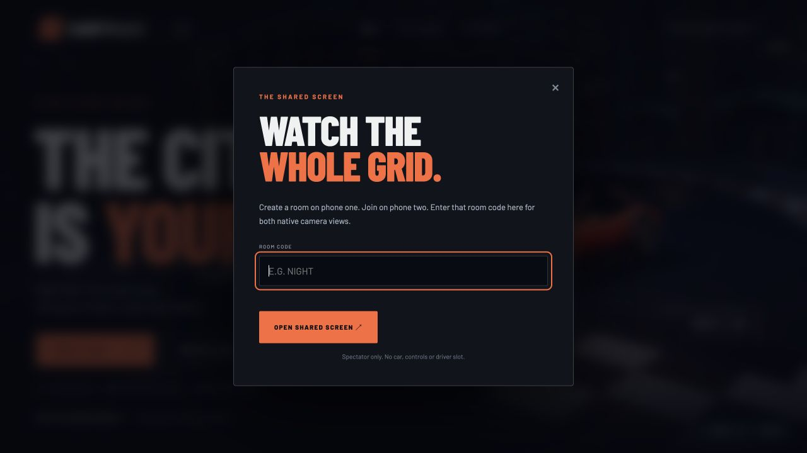

# F1-inspired Comfy Race: feasibility and tested workflow

Reviewed 2 November 2026. Engine choice remains **actual native Matrix racing**. Two humans in one shared race are mandatory.

## Decision

An immersive motorsport game with Comfy-authored experience packs is feasible. A prompt alone does not turn the current Matrix street car into a Formula simulator, create Nairobi roads or provide multiplayer authority. Those features need explicit native engine support.

The recommended product has two real driving classes eventually: a street class and an open-wheel arcade class. Both use the same multiplayer infrastructure. City experience packs supply supported route choices, event scripts, presentation and integrated audio/visual assets. Five city themes across two implemented classes would give ten themed combinations, **not ten new geographic maps**. Only the standard native street-car preset is implemented today.

## What has actually been tested

- Authenticated Cloud node catalog: HTTP 200; 3,858 node definitions listed. Relevant entries include GeminiNodeV3, SaveText, ElevenLabs speech/SFX, video nodes and 3D-generation nodes. Listing a node does not prove its models, credits or game integration work.
- Created and saved [Nairobi Experience Director v1](https://cloud.comfy.org/#e34071ee-1a6d-4c8b-8783-3646d19db617) in the user's Comfy workspace.
- Workflow: Gemini 3.1 Flash-Lite -> SaveText(JSON), with a 1,024-output-token cap. Comfy's no-spend preflight passed.
- After explicit approval for one paid text test, Cloud job 04eb4f8e-dd10-44a9-8d33-e418d8c804b5 completed successfully.
- Downloaded its actual JSON output; it passes the game's strict experience validator and selects the native Avenue route.
- Preserved the generated output and a reviewed version. The generated briefing incorrectly conflated contact and recovery penalties; the reviewed version corrects that wording. Schema validation cannot establish that every natural-language sentence is true.
- Added host-only manifest application: actual native route selection, fresh state/epoch check, readiness reset and a frozen shared manifest until the next heat.
- Added a projector spectator role so two phones can occupy both driver slots. The shared screen receives both native camera feeds and has no driving/host authority.
- Added a motorsport timing tower using real checkpoint/penalty/finish data, plus event-linked radio text.
- Nineteen Node tests and twenty existing Python tests pass locally. Browser inspection verifies the projector entry UI. Native rules tests previously passed. **Rendered two-human gameplay still requires a desktop-session test.**

Evidence and artifacts are in [workflows/experiences](../workflows/experiences/README.md). No extra video, image, audio or 3D generation was run for this pilot.

The saved workflow was read back through the authenticated API as a two-node graph. The browser check reopened an unrelated unsaved workflow instead of that record. The cause is unconfirmed; the active browser workspace may differ from the API-key workspace. An editable JSON export is included so the graph can be imported directly into the active canvas.

## Capability boundaries

| Desired feature | Comfy contribution | Native/application work | Current status |
|---|---|---|---|
| Multiplayer competition | Author a shared experience | Matrix physics/session, authenticated controls, rooms and results | Gateway implemented; physical rendered demo pending |
| F1-style broadcast | Copy, palette and event scripts | Live timing tower and transitions driven by native telemetry | Implemented presentation |
| Street versus open-wheel cars | Reference designs, textures or generated meshes | Vehicle import/geometry, wheel anchors, collider and a tested handling preset | Street default only; open-wheel requires native work |
| Nairobi/Tokyo/etc atmosphere | Briefing, radio, ambience, appearance assets/prompts | Asset playback/material/lighting integration | Narrative themes implemented; generated world assets not integrated |
| Different real city roads | Potential environment assets | New road mesh, collision, lane graph, route/grid/recovery data | Not implemented |
| Live AI game imagery | ComfyStream workflow using live native frames | Persistent GPU, WebRTC, conditioning and two-view latency/fidelity tests | Unverified |
| Tyres, pit stops, multi-lap circuits | Dialogue or configuration for supported rules | New authoritative game mechanics | Not implemented |

The native source currently caps human cars at 80 km/h. All multiplayer humans instantiate vehicle model 0. Handling settings apply globally; a one-time per-car grip assignment would be overwritten each update. Physics starts from a road-car baseline, not Formula aerodynamics or tyre simulation. Five vehicle model records exist in the downloaded assets, but native human car selection is not exposed. Generated GLB files cannot be dropped directly into the custom asset loader. [World](https://github.com/SkyworkAI/Matrix-Game/blob/51913b2bfa78a6d54de912b8348b1d318f4d36e2/Matrix-Game-4/game/racing/src/World.cpp), [speed cap](https://github.com/SkyworkAI/Matrix-Game/blob/51913b2bfa78a6d54de912b8348b1d318f4d36e2/Matrix-Game-4/game/racing/src/World.h#L9), [physics](https://github.com/SkyworkAI/Matrix-Game/blob/51913b2bfa78a6d54de912b8348b1d318f4d36e2/Matrix-Game-4/game/racing/src/Physics.cpp).

The Matrix project demo combines an authoritative low-poly game with a specialized causal video renderer. That supports investigating live neural visuals, but does not establish arbitrary Formula cars, new cities or two generated multiplayer views on our hardware. [Project page](https://matrix-game-v4-0.github.io/page/).

## Two phones and one projector

1. Run the supplied launcher on the laptop in a normal desktop session. Connect both phones to the same reachable Wi-Fi/LAN service.
2. Phone one opens the game at the laptop's LAN address and creates a room in controller mode. It is the host and first driver.
3. Phone two scans the room QR code and joins as the second driver.
4. The laptop opens **Open the shared screen** and enters the room code, or follows the room's projector link. Its URL uses view=projector. It consumes no driver slot.
5. Phone one can load the reviewed Nairobi pilot with one button, or import another valid manifest. This uses saved output and submits no new generation.
6. Both phones confirm ready; phone one starts. Everyone watches the two native camera views on the shared screen. Phones send steering/throttle/brake and receive HUD data, not video.
7. A disconnect pauses the native race. Reconnect, ready both phones and resume from the phone host.

The three-client transport test verifies that the projector creates no third native player, cannot start the race, receives both image streams, and sends no image payloads to either phone. This is a test fixture for transport, not evidence of a human-driven race.

## What to prompt in Comfy

### Experience director: supported today

> Build a reusable Comfy Race experience-authoring workflow using the available Gemini 3.1 Flash-Lite node and SaveText in JSON format. Use the attached native-capabilities.json as the source of truth. For this pilot choose Nairobi-inspired motorsport presentation, native route avenue, vehiclePresetId matrix-street-default-v1 and rulesPresetId native-checkpoint-sprint. Return only schemaVersion 1, id, title, cityTheme, routeId, vehiclePresetId, rulesPresetId, presentation, briefing and radio. Presentation contains style and accent; radio contains start, checkpoint and finish. Do not invent physics, road geometry, lap/tyre/pit mechanics or Formula vehicle support. Keep briefing under 400 characters and each radio line under 160. Save the JSON, and export API format. Keep optional audio/3D/video branches disabled.

The tested [API graph](../workflows/experiences/nairobi-director-api.json) already does this. The graph JSON goes into Comfy. Its generated **manifest JSON** goes into the game's host experience loader. They are different files.

### Audio: next workflow branch

> Produce short original race-radio lines and a seamless trackside ambience loop for a Nairobi-inspired city sprint. Use only supported TTS/SFX nodes. No fabricated winner, lap or pit information. Export separate start/checkpoint/finish clips and an ambience loop. Do not generate a full race movie.

The catalog includes relevant ElevenLabs nodes; this branch has not been run. Assets must be downloaded, preloaded and triggered from native events. Engine sound pitch/volume should follow actual telemetry rather than a narration model. Current radio cues are text only. [TTS](https://docs.comfy.org/built-in-nodes/ElevenLabsTextToSpeech), [SFX](https://docs.comfy.org/built-in-nodes/ElevenLabsTextToSoundEffects).

### Open-wheel assets: requires an import pipeline

> Create an original open-wheel race-car asset with identifiable body, four wheels, front/rear wings and material groups. Export the supported mesh format and report scale/origin. Aim for a game-ready mesh; do not claim correct collision, rigging or physics.

This is an asset-generation request. We must inspect/convert the result, establish wheel anchors, fit a collider and implement the native vehicle profile before players can drive it. Comfy's 3D outputs do not implement that work. [Hunyuan3D example](https://docs.comfy.org/tutorials/3d/hunyuan3D-2).

### Live world rendering: a separate experiment

Use a prompt that preserves road layout, viewpoint, car pose and reference appearance while asking for the target city's visual atmosphere. These are soft constraints, not guarantees. First test a single view, then both drivers' views; prove steering, identity and road continuity before using it as the competitive display. A queued Cloud video generator is not a replacement for this live control loop. [ComfyStream](https://docs.comfystream.org/technical/get-started/introduction).

## What API calls can do

| Surface | Calls used or supported | Role |
|---|---|---|
| Comfy Cloud | GET /api/user and /api/object_info | Authentication and actual node discovery |
| Cloud MCP | submit_workflow(dry_run), estimate_credits, save_workflow | Validate, inspect costs and save a graph without generation |
| Cloud MCP | submit_workflow(confirm), wait_for_job, get_output | The approved paid pilot and artifact retrieval |
| Official SDK | Comfy(...), workflows.from_file, run(...), output download | Automate the same workflow/artifact process from app code |
| Game HTTP | GET /api/experience/capabilities and reviewed pilot example | Discover supported engine choices and reuse reviewed output |
| Game WebSocket | create/join/watch/ready/start/input/apply_experience | Multiplayer roles, controls and host-approved manifest application |
| Native IPC | join, ready, input, select_route, native state/media | Actual game authority and camera output |

Codex can coordinate Cloud through its authenticated API/MCP even if the in-canvas assistant cannot access GitHub. This coordination was demonstrated by saving and running the pilot directly. Keys remain server-side, not on phones or inside exported graphs.

For partner nodes, the official Python SDK distinguishes server authentication from per-run partner authentication: pass the same workspace key to the constructor and to run(..., api_key=key). Follow a returned job ID; do not automatically resubmit an uncertain paid job. [SDK](https://github.com/Comfy-Org/comfy-python-sdk).

## The supplied F1 UI ZIP

The [Devon Yu CodePen](https://codepen.io/devon_yu/pen/vYEbGaa) is MIT-licensed UI reference code. Its variable named API is a hardcoded driver list; random increments simulate movement, intervals are calculated from invented distance, and laps/tyres/pits are not native game state. We did not copy its code, driver data, photographs or external media. Our new timing tower uses Matrix checkpoint progress and verified finish totals. Continuous race intervals require additional native route-distance/common-checkpoint timing instrumentation.

## Build order that keeps the demo credible

1. Finish the actual rendered two-phone race on the desktop session.
2. Exercise the reviewed Comfy manifest: show the selected Avenue route, briefing, shared hash and radio text in play.
3. Add and test a real native open-wheel proxy/handling preset, one class per heat initially.
4. Integrate event-triggered audio and a second city experience pack.
5. Add live Comfy rendering only after two-view fidelity and input latency pass.
6. Build geographic city maps, circuits, tyres and pit rules as separate engine projects.

The first two steps now have code, workflow artifacts and passing contract tests. Rendered gameplay remains the outstanding acceptance gate; a new screenshot or generated movie cannot substitute for it.
